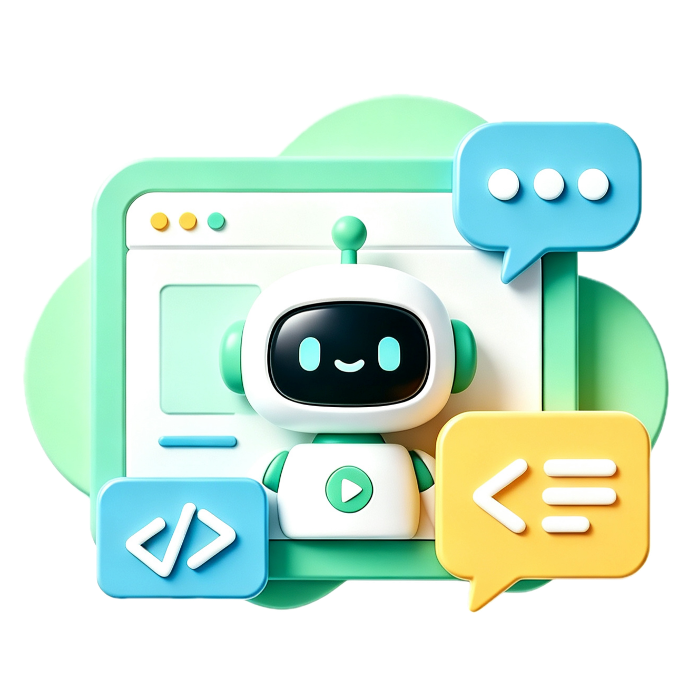
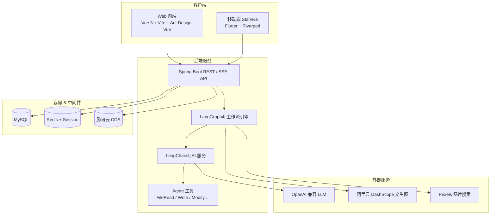

<div align="center">



# 星衍 · AI Code Mother

**以灵感为星，衍万千应用**

基于大语言模型的 AI 零代码应用生成平台。输入自然语言描述，即可流式生成可预览、可部署、可下载的 Web 应用。

[](https://openjdk.org/)
[](https://spring.io/projects/spring-boot)
[](https://vuejs.org/)
[](https://flutter.dev/)

</div>

---

## ✨ 核心特性

| 能力 | 说明 |
|------|------|
| **对话式生成** | SSE 流式输出，实时展示 AI 生成过程，支持多轮对话迭代 |
| **多种生成模式** | 原生 HTML、多文件 HTML、完整 Vue 工程三种代码生成类型 |
| **LangGraph 工作流** | 图片资源并发收集 → 提示词增强 → 智能路由 → 代码生成 → 质量检查 → 项目构建 |
| **AI Agent 工具链** | 文件读写 / 修改 / 删除 / 目录浏览，支持 Agent 自主操作代码 |
| **一键部署预览** | 生成后即时预览，支持部署至独立域名并生成封面截图 |
| **应用广场** | 精选案例展示、点赞、评论，支持用户主页与作品列表 |
| **多端覆盖** | Web 管理端 + Flutter 移动端（Starvive），共享同一套后端 API |
| **管理后台** | 用户 / 应用 / 对话历史管理，角色权限控制 |

## ⚙️ 技术架构



## 📁 项目结构

```
ai-code-mother/
├── src/                          # Spring Boot 后端
│   └── main/java/com/wbq/aicodemother/
│       ├── ai/                   # LangChain4j AI 服务 & Agent 工具
│       ├── langgraph4j/          # LangGraph4j 工作流节点
│       ├── core/                 # 代码解析、保存、构建
│       ├── controller/           # REST / SSE 接口
│       ├── service/              # 业务逻辑
│       └── ...
├── ai-code-mother-frontend/      # Vue 3 Web 前端
├── Starvive/                     # Flutter 移动端客户端
├── sql/                          # 数据库初始化脚本
└── env.example                   # 环境变量模板
```

## 🛠 技术栈

### 后端

| 技术 | 用途 |
|------|------|
| Spring Boot 4.1 + Java 21 | 主框架 |
| LangChain4j | LLM 接入、流式对话、Agent 工具调用 |
| LangGraph4j | 多节点 AI 工作流编排 |
| MyBatis-Flex | ORM 数据访问 |
| MySQL | 持久化存储 |
| Redis + Spring Session | 会话管理 & 缓存 |
| Redisson | 分布式限流 |
| Selenium | 网页截图 |
| 腾讯云 COS | 对象存储（封面、部署资源） |
| Knife4j | API 文档 |

### Web 前端

| 技术 | 用途 |
|------|------|
| Vue 3 + TypeScript | UI 框架 |
| Vite 8 | 构建工具 |
| Ant Design Vue 4 | 组件库 |
| Pinia | 状态管理 |
| Axios + SSE | HTTP 请求 & 流式通信 |

### 移动端

| 技术 | 用途 |
|------|------|
| Flutter 3.11+ | 跨平台客户端 |
| Riverpod | 状态管理 |
| go_router | 路由 & 权限守卫 |
| Dio + CookieJar | HTTP + Session 持久化 |
| WebView | 应用预览 |

## 🚀 快速开始

### 环境要求

- JDK 21+
- Node.js 22+ / 24+
- MySQL 8.0+
- Redis 6.0+
- Maven 3.9+（或使用项目自带的 `./mvnw`）
- Flutter SDK 3.11+（仅移动端需要）

### 1. 克隆项目

```bash
git clone git@github.com:wangbaoqing587/ai-code-mother.git
cd ai-code-mother
```

### 2. 初始化数据库

```bash
mysql -u root -p < sql/create_table.sql
```

### 3. 配置环境变量

```bash
cp env.example .env
```

编辑 `.env`，至少配置以下项：

```bash
# LLM（OpenAI 兼容接口，默认 DeepSeek）
LLM_BASE_URL=https://api.deepseek.com
LLM_API_KEY=your-api-key
LLM_CHAT_MODEL_NAME=deepseek-chat
LLM_STREAMING_MODEL_NAME=deepseek-chat
LLM_REASONING_MODEL_NAME=deepseek-reasoner
LLM_ROUTING_MODEL_NAME=deepseek-chat

# Redis
REDIS_HOST=localhost
REDIS_PORT=6379

# 可选：图片 & 存储
PEXELS_API_KEY=
DASHSCOPE_API_KEY=
COS_HOST=
COS_SECRET_ID=
COS_SECRET_KEY=
COS_REGION=
COS_BUCKET=
```

同时修改 `src/main/resources/application.yaml` 中的 MySQL 连接信息。

### 4. 启动后端

```bash
set -a && source .env && set +a && ./mvnw spring-boot:run
```

后端默认运行在 `http://localhost:8123/api`

### 5. 启动 Web 前端

```bash
cd ai-code-mother-frontend
npm install
npm run dev
```

前端开发服务器会通过 Vite 代理将 `/api` 转发至后端。

### 6. 启动移动端（可选）

```bash
cd Starvive
flutter pub get
flutter run
```

真机调试时需指定局域网 IP：

```bash
flutter run --dart-define=API_BASE_URL=http://192.168.x.x:8123/api
```

更多移动端说明见 [Starvive/README.md](Starvive/README.md)。

## 📖 API 文档

后端启动后访问 Knife4j 文档：

```
http://localhost:8123/api/doc.html
```

## 🔄 AI 工作流

代码生成采用 LangGraph4j 编排的多节点并发工作流：

```
START
  → 图片资源规划 (ImagePlan)
  → ┬ 内容图片收集 (Pexels)
    ├ 插画收集 (Undraw)
    ├ 架构图生成 (Mermaid)
    └ Logo 生成 (DashScope)
  → 图片聚合 (ImageAggregator)
  → 提示词增强 (PromptEnhancer)
  → 生成类型路由 (Router)
  → 代码生成 (CodeGenerator)
  → 代码质量检查 (CodeQualityCheck)
  → 项目构建 (ProjectBuilder)
  → END
```

支持三种代码生成类型：

| 类型 | 说明 |
|------|------|
| `html` | 单文件原生 HTML |
| `multi_file` | 多文件 HTML（HTML + CSS + JS） |
| `vue_project` | 完整 Vue 工程，可下载 & 本地运行 |

## 🌐 主要接口

| 能力 | 端点 |
|------|------|
| 用户注册 / 登录 | `POST /user/register` · `POST /user/login` |
| 创建应用 | `POST /app/add` |
| 流式生成代码 | `GET /app/chat/gen/code?appId=&message=` (SSE) |
| 应用预览 | `GET /static/{codeGenType}_{appId}/` |
| 部署应用 | `POST /app/deploy` |
| 下载源码 | `GET /app/download/{appId}` |
| 聊天历史 | `GET /chatHistory/app/{appId}` |

## 📱 客户端功能对比

| 功能 | Web | Flutter |
|------|-----|---------|
| 提示词创建应用 | ✅ | ✅ |
| SSE 流式对话 | ✅ | ✅ |
| 实时预览 | ✅ | ✅ |
| 可视化编辑 | ✅ | ❌ |
| 部署 & 下载 | ✅ | ✅ |
| 应用广场 / 点赞 / 评论 | ✅ | ✅ |
| 管理后台 | ✅ | ✅ |

## 📸 页面展示

> 截图存放于 [`docs/screenshots/`](docs/screenshots/)，将 PNG 放入对应路径后，把下方 `.svg` 改为 `.png` 即可。

### 首页 · 一句话创建应用

输入自然语言描述或选择快捷提示词，即可创建 AI 应用。首页同时展示**精选案例**与**应用广场**，方便浏览与复用他人作品。


### AI 对话 · 流式生成 & 实时预览

进入对话页后，左侧为 SSE 流式 AI 对话区，右侧为 iframe 实时预览。支持多轮对话迭代优化，生成过程 Markdown 实时渲染。


### 可视化编辑

预览区内点击页面元素，选中后通过对话描述修改需求，AI 精准改动对应 DOM，无需手写代码。


### 一键部署 & 源码下载

生成完成后可一键部署至独立访问地址，自动截取封面图；Vue 工程模式支持打包下载完整源码 zip。


### 应用广场 · 点赞 & 评论

浏览广场应用，查看详情、点赞、发表评论；点击创作者头像进入用户主页，浏览其全部公开作品。


### 我的作品

登录后在「我的作品」页管理个人应用，支持进入对话、编辑信息、部署、下载与删除。


### 管理后台

管理员可管理全部用户、应用与对话历史，支持搜索、分页、优先级调整与内容审核。


## 📄 License

本项目暂未指定开源协议。如需使用或二次开发，请联系作者。

---

<div align="center">
  <sub>Built with ❤️ by <a href="https://github.com/wangbaoqing587">wangbaoqing587</a></sub>
</div>
