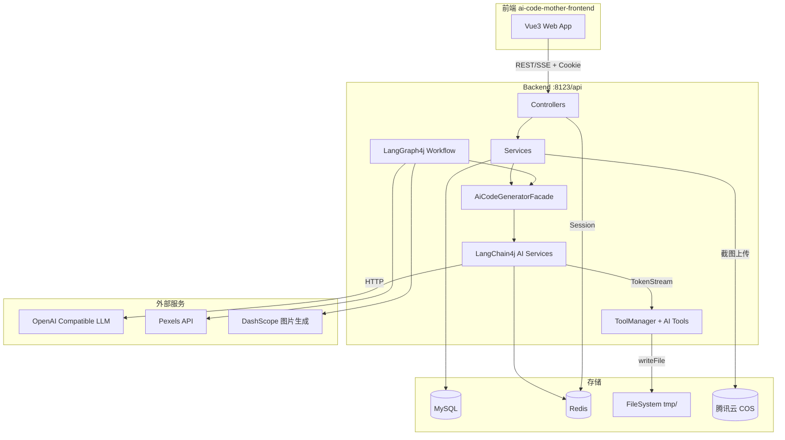

# ai-code-mother 项目架构文档

> 版本：0.0.1-SNAPSHOT  
> 最后更新：2026-08-28

---

## 目录

1. [项目概述](#1-项目概述)
2. [技术栈](#2-技术栈)
3. [系统架构](#3-系统架构)
4. [代码目录结构](#4-代码目录结构)
5. [核心模块说明](#5-核心模块说明)
6. [LangGraph4j 工作流](#6-langgraph4j-工作流)
7. [数据库设计](#7-数据库设计)
8. [REST API 接口文档](#8-rest-api-接口文档)
9. [核心业务流程](#9-核心业务流程)
10. [AI 集成方案](#10-ai-集成方案)
11. [配置说明](#11-配置说明)
12. [部署与运行](#12-部署与运行)
13. [注意事项与已知问题](#13-注意事项与已知问题)

---

## 1. 项目概述

**ai-code-mother** 是一个基于 AI 的「对话式代码生成平台」，包含 Spring Boot 后端与 Vue3 前端。用户通过自然语言与 AI 对话，驱动 AI 自动生成前端代码，支持三种生成模式：

| 模式 | 枚举值 | 说明 |
|------|--------|------|
| 原生 HTML | `html` | 生成单个 HTML 文件 |
| 多文件 | `multi_file` | 生成 HTML + CSS + JS 三文件 |
| Vue 工程 | `vue_project` | 生成完整 Vue3 + Vite 工程 |

核心能力：

- 流式 SSE 实时输出 AI 生成内容
- 创建应用时 AI 智能路由代码生成类型 + AI 生成应用名
- 对话历史持久化（MySQL）+ AI 记忆（Redis）
- Vue 项目工具调用写文件 + 同步 `npm install` / `npm run build`
- 一键部署预览、代码 ZIP 下载、部署后自动截图上传 COS
- LangGraph4j 多节点代码生成工作流（实验性）
- 用户级限流、精选应用 Redis 缓存

仓库结构：

| 目录 | 说明 |
|------|------|
| `src/` | Spring Boot 后端 |
| `ai-code-mother-frontend/` | Vue3 + Vite 前端 |
| `sql/` | 数据库建表脚本 |
| `docs/` | 架构文档 |
| `env.example` | 环境变量模板 |

---

## 2. 技术栈

### 2.1 后端

| 类别 | 技术 | 版本 |
|------|------|------|
| 语言 | Java | 21 |
| 框架 | Spring Boot | 4.1.0 |
| ORM | MyBatis-Flex | 1.11.8 |
| 数据库 | MySQL | 8+ |
| 连接池 | HikariCP | 4.0.3 |
| 缓存/Session | Spring Session + Redis | parent 管理 |
| 分布式锁/限流 | Redisson | 3.50.0 |
| AI 框架 | LangChain4j | 1.18.0 |
| AI Starter | langchain4j-open-ai-spring-boot4-starter | 1.18.0-beta28 |
| AI Redis | langchain4j-community-redis-spring-boot4-starter | 1.18.0-beta28 |
| 响应式 | langchain4j-reactor | 1.1.0-beta7 |
| 工作流 | LangGraph4j | 1.8.20 |
| 本地缓存 | Caffeine | parent 管理 |
| 对象存储 | 腾讯云 COS SDK | 5.6.227 |
| 图片生成 | 阿里云 DashScope SDK | 2.22.30 |
| 网页截图 | Selenium + WebDriverManager | 4.33.0 / 6.1.0 |
| 工具库 | Hutool | 5.8.46 |
| API 文档 | Knife4j (OpenAPI3) | 4.4.0 |

### 2.2 前端

| 类别 | 技术 | 版本 |
|------|------|------|
| 框架 | Vue | 3.5 |
| 构建 | Vite | 8.x |
| UI | Ant Design Vue | 4.2 |
| 状态 | Pinia | 4.x |
| 路由 | Vue Router | 5.x |
| HTTP | Axios | 1.x |
| Markdown | markdown-it + highlight.js | — |

---

## 3. 系统架构

### 3.1 分层架构

```
┌──────────────────────────────────────────────────────────────────┐
│  Controller 层                                                    │
│  AppController / UserController / ChatHistoryController             │
│  StaticResourceController / WorkflowSseController / HealthController│
└──────────────────────────┬───────────────────────────────────────┘
                           │
┌──────────────────────────▼───────────────────────────────────────┐
│  Service 层                                                       │
│  AppServiceImpl / UserServiceImpl / ChatHistoryServiceImpl          │
│  ScreenshotService / ProjectDownloadService                         │
└──────────────────────────┬───────────────────────────────────────┘
                           │
┌──────────────────────────▼───────────────────────────────────────┐
│  Core 层（业务编排）                                               │
│  AiCodeGeneratorFacade                                            │
│  StreamHandlerExecutor / CodeParserExecutor / CodeFileSaverExecutor│
│  VueProjectBuilder                                                │
└──────────────────────────┬───────────────────────────────────────┘
                           │
┌──────────────────────────▼───────────────────────────────────────┐
│  AI 层                                                            │
│  AiCodeGeneratorServiceFactory / AiCodeGenTypeRoutingServiceFactory│
│  AiAppNameServiceFactory / ToolManager / Guardrails               │
│  LangChain4j (ChatModel / StreamingChatModel / TokenStream)       │
└──────────────────────────┬───────────────────────────────────────┘
                           │
┌──────────────────────────▼───────────────────────────────────────┐
│  LangGraph4j 工作流（实验性，独立于主业务 API）                      │
│  CodeGenWorkflow / CodeGenConcurrentWorkflow + Nodes + Tools      │
└──────────────────────────┬───────────────────────────────────────┘
                           │
┌──────────────────────────▼───────────────────────────────────────┐
│  基础设施                                                         │
│  MySQL / Redis（Session + ChatMemory + 限流 + 缓存）             │
│  COS（封面截图）/ 文件系统（tmp/code_output, tmp/code_deploy）      │
│  外部 API（LLM / Pexels / DashScope）                             │
└──────────────────────────────────────────────────────────────────┘
```

### 3.2 横切关注点

| 能力 | 实现方式 |
|------|----------|
| 认证 | Spring Session（Redis 存储），Session Key = `user_login` |
| 鉴权 | `@AuthCheck(mustRole = "admin")` + `AuthInterceptor` AOP |
| 限流 | `@RateLimit` + Redisson 滑动窗口（AI 对话：每用户 60s 内 3 次） |
| 缓存 | `@Cacheable` 精选应用列表（Redis，前 10 页） |
| 异常 | `GlobalExceptionHandler` 统一处理 `BusinessException` |
| 跨域 | `CorsConfig` 全局放行 |
| API 文档 | Knife4j + springdoc-openapi |

### 3.3 系统交互图



---

## 4. 代码目录结构

```
ai-code-mother/
├── pom.xml
├── env.example                              # 环境变量模板
├── sql/create_table.sql
├── docs/ARCHITECTURE.md
├── ai-code-mother-frontend/                 # Vue3 前端
│   ├── src/
│   │   ├── api/                             # OpenAPI 生成的接口客户端
│   │   ├── pages/                           # 页面（首页/对话/管理后台）
│   │   ├── components/                      # 通用组件（SSE 渲染、输入框等）
│   │   ├── stores/                          # Pinia 状态
│   │   ├── utils/sse.ts                     # SSE 工具
│   │   └── config/env.ts                    # API / 部署域名配置
│   └── package.json
├── src/main/java/com/wbq/aicodemother/
│   ├── annotation/                          # @AuthCheck
│   ├── aop/                                 # AuthInterceptor
│   ├── ai/                                  # LangChain4j AI 服务
│   │   ├── AiCodeGeneratorService.java
│   │   ├── AiCodeGeneratorServiceFactory.java
│   │   ├── AiCodeGenTypeRoutingService*.java
│   │   ├── AiAppNameService*.java
│   │   ├── guardrail/                       # 输入/输出护轨
│   │   ├── memory/ValidatingChatMemoryStore.java
│   │   ├── model/                           # 结构化输出 + 流式消息
│   │   └── tools/                           # FileWrite/Read/Modify/Delete 等
│   ├── cache/                               # 缓存失效
│   ├── config/                              # Spring 配置（模型/COS/Redis/截图）
│   ├── controller/                          # REST 控制器
│   ├── core/                                # 代码生成编排
│   │   ├── AiCodeGeneratorFacade.java
│   │   ├── builder/VueProjectBuilder.java
│   │   ├── handler/                         # 流式响应后处理
│   │   ├── parser/                          # HTML/MultiFile 解析
│   │   └── saver/                           # 文件落盘
│   ├── langgraph4j/                         # LangGraph4j 工作流
│   │   ├── CodeGenWorkflow.java             # 串行工作流
│   │   ├── CodeGenConcurrentWorkflow.java   # 并发图片收集工作流
│   │   ├── node/                            # 各工作流节点
│   │   ├── tools/                           # 图片搜索/Logo/Mermaid 等
│   │   └── state/WorkflowContext.java
│   ├── manager/CosManager.java
│   ├── ratelimit/                           # Redisson 限流
│   ├── service/                             # 业务服务层
│   └── utils/WebScreenshotUtils.java
└── src/main/resources/
    ├── application.yaml                     # 主配置（支持环境变量）
    ├── mapper/
    └── prompt/                              # AI System Prompt
```

运行时目录（gitignore）：

```
tmp/
├── code_output/
│   ├── html_{appId}/
│   ├── multi_file_{appId}/
│   └── vue_project_{appId}/    # 含 dist/
└── code_deploy/
    └── {deployKey}/
```

---

## 5. 核心模块说明

### 5.1 AiCodeGeneratorFacade

代码生成统一入口，按 `CodeGenTypeEnum` 分发：

| 类型 | AI 调用 | 流式输出 | 后处理 |
|------|---------|----------|--------|
| HTML | `generateHtmlCodeStream` | `Flux<String>` | 流结束后解析 + 保存 `index.html` |
| MULTI_FILE | `generateMultiFileCodeStream` | `Flux<String>` | 流结束后解析 + 保存三文件 |
| VUE_PROJECT | `generateVueProjectCodeStream` | `TokenStream` → JSON 消息 | 工具写文件 + **同步** npm build |

### 5.2 AiCodeGeneratorServiceFactory

- 按 `appId + codeGenType` 缓存 AI 服务实例（Caffeine，最大 1000，写后 30min / 访问后 10min 过期）
- 每个应用独立 `MessageWindowChatMemory`（最多 20 条，Redis 持久化）
- 创建实例时从 `chat_history` 加载历史到记忆，AI 消息会清理工具调用标记
- VUE_PROJECT 使用 `reasoningStreamingChatModelPrototype`（prototype 作用域，避免并发冲突）
- HTML/MULTI_FILE 使用 `streamingChatModelPrototype` + 同步 `ChatModel`
- VUE_PROJECT 注册 `ToolManager` 全部工具，最大工具调用轮次 20
- 输入护轨：`PromptSafetyInputGuardrail`

### 5.3 AI 工具集（VUE_PROJECT）

| 工具 | 说明 |
|------|------|
| `FileWriteTool` | 写入项目文件 |
| `FileReadTool` | 读取项目文件 |
| `FileModifyTool` | 修改项目文件 |
| `FileDeleteTool` | 删除项目文件 |
| `FileDirReadTool` | 读取目录结构 |
| `ExitTool` | 结束工具调用循环 |

### 5.4 StreamHandlerExecutor

流式响应后处理路由：

- `HTML / MULTI_FILE` → `SimpleTextStreamHandler`：收集完整文本，保存 AI 回复到 `chat_history`
- `VUE_PROJECT` → `JsonMessageStreamHandler`：解析 JSON 消息（AI 文本 / 工具请求 / 工具执行），格式化输出，保存历史

### 5.5 AppServiceImpl 关键逻辑

**创建应用**（并行执行）：

1. `AiAppNameService` 生成应用名（失败则取 prompt 前 12 字符）
2. `AiCodeGenTypeRoutingService` 智能选择 `html / multi_file / vue_project`
3. 初始 `genStatus = idle`

**对话生成**：

1. 校验权限 + `genStatus != generating`
2. 保存用户消息 → 更新 `genStatus = generating`
3. 调用 `AiCodeGeneratorFacade`，3 分钟超时
4. 完成 → `idle`，失败 → `failed`

**部署**：

1. 复制 `tmp/code_output/{codeGenType}_{appId}/` → `tmp/code_deploy/{deployKey}/`
2. Vue 项目返回 URL 追加 `/dist/index.html`
3. 异步 Selenium 截图 → 上传 COS → 更新 `cover`

### 5.6 VueProjectBuilder

代码生成完成后**同步**执行（阻塞 SSE 完成事件）：

1. `npm install`（超时 5 分钟）
2. `npm run build`（超时 3 分钟）
3. 验证 `dist/` 目录生成

---

## 6. LangGraph4j 工作流

独立于主业务 API 的实验性模块，通过 `WorkflowSseController` 暴露。

### 6.1 CodeGenWorkflow（串行）

```
START → image_collector → prompt_enhancer → router → code_generator
      → code_quality_check ─┬─ fail → code_generator（重试）
                            ├─ skip_build → END（HTML/MULTI_FILE）
                            └─ build → project_builder → END（VUE_PROJECT）
```

### 6.2 CodeGenConcurrentWorkflow（并发图片收集）

```
START → image_plan ─┬→ content_image_collector ─┐
                    ├→ illustration_collector ──┤
                    ├→ diagram_collector ────────┼→ image_aggregator → prompt_enhancer → ...
                    └→ logo_collector ───────────┘
```

### 6.3 工作流工具

| 工具 | 说明 |
|------|------|
| `ImageSearchTool` | Pexels 图片搜索 |
| `LogoGeneratorTool` | DashScope 生成 Logo |
| `MermaidDiagramTool` | Mermaid 图表生成 |
| `UndrawIllustrationTool` | 插画资源 |

### 6.4 工作流 API

| 方法 | 路径 | 说明 |
|------|------|------|
| POST | `/api/workflow/execute` | 同步执行，返回 `WorkflowContext` |
| GET | `/api/workflow/execute-flux?prompt=` | Flux SSE 流式 |
| GET | `/api/workflow/execute-sse?prompt=` | SseEmitter 流式 |

> 工作流内 `CodeGeneratorNode` 当前使用固定 `appId=0`，尚未与业务应用体系完全整合。

---

## 7. 数据库设计

### 7.1 ER 关系

```
user (1) ──── (N) app (1) ──── (N) chat_history
```

### 7.2 表结构

#### user

| 字段 | 类型 | 说明 |
|------|------|------|
| id | bigint PK | 用户 ID |
| userAccount | varchar(256) UNIQUE | 账号 |
| userPassword | varchar(512) | 密码（MD5 + 盐） |
| userName | varchar(256) | 昵称 |
| userAvatar | varchar(1024) | 头像 URL |
| userProfile | varchar(512) | 简介 |
| userRole | varchar(256) DEFAULT 'user' | user / admin |
| editTime / createTime / updateTime | datetime | 时间戳 |
| isDelete | tinyint DEFAULT 0 | 逻辑删除 |

#### app

| 字段 | 类型 | 说明 |
|------|------|------|
| id | bigint PK | 应用 ID（实体层使用雪花算法） |
| appName | varchar(256) | 应用名称 |
| cover | varchar(512) | 封面（COS 截图 URL） |
| initPrompt | text | 初始化 prompt |
| codeGenType | varchar(64) | html / multi_file / vue_project |
| genStatus | varchar(32) DEFAULT 'idle' | idle / generating / failed |
| deployKey | varchar(64) UNIQUE | 部署标识（6 位随机字符串） |
| deployedTime | datetime | 部署时间 |
| priority | int DEFAULT 0 | 优先级（99 = 精选） |
| userId | bigint | 创建用户 ID |
| editTime / createTime / updateTime | datetime | 时间戳 |
| isDelete | tinyint DEFAULT 0 | 逻辑删除 |

#### chat_history

| 字段 | 类型 | 说明 |
|------|------|------|
| id | bigint PK | 记录 ID（雪花算法） |
| message | mediumtext | 消息内容 |
| messageType | varchar(32) | user / ai |
| appId | bigint | 应用 ID |
| userId | bigint | 用户 ID |
| createTime / updateTime | datetime | 时间戳 |
| isDelete | tinyint DEFAULT 0 | 逻辑删除 |

**索引**：`idx_appId_createTime(appId, createTime)` — 游标分页核心索引

### 7.3 枚举

| 枚举 | 值 | 说明 |
|------|-----|------|
| `CodeGenTypeEnum` | html, multi_file, vue_project | 代码生成类型 |
| `AppGenStatusEnum` | idle, generating, failed | 代码生成状态 |
| `ChatHistoryMessageTypeEnum` | user, ai | 消息类型 |
| `UserRoleEnum` | user, admin | 用户角色 |

---

## 8. REST API 接口文档

> **全局前缀**：`/api`  
> **统一响应**：`BaseResponse<T> { code, data, message }`，成功时 `code = 0`  
> **认证方式**：Session Cookie  
> **在线文档**：`http://localhost:8123/api/doc.html`

### 8.1 错误码

| code | 说明 |
|------|------|
| 0 | 成功 |
| 40000 | 请求参数错误 |
| 40100 | 未登录 |
| 40101 | 无权限 |
| 40300 | 禁止访问 |
| 40400 | 数据不存在 |
| 50000 | 系统内部异常 |
| 50001 | 操作失败 |

### 8.2 健康检查

**GET** `/api/health/` — 公开，返回 `{ "code": 0, "data": "ok" }`

### 8.3 用户模块 `/api/user`

| 方法 | 路径 | 权限 | 说明 |
|------|------|------|------|
| POST | `/user/register` | 公开 | 注册 |
| POST | `/user/login` | 公开 | 登录 |
| GET | `/user/get/login` | 登录 | 获取当前用户 |
| POST | `/user/logout` | 登录 | 退出 |
| POST | `/user/add` | admin | 创建用户 |
| GET | `/user/get?id=` | admin | 获取用户 |
| POST | `/user/delete` | admin | 删除用户 |
| POST | `/user/update` | admin | 更新用户 |
| POST | `/user/list/page/vo` | admin | 分页查询 |

### 8.4 应用模块 `/api/app`

| 方法 | 路径 | 权限 | 说明 |
|------|------|------|------|
| POST | `/app/add` | 登录 | 创建应用（AI 路由类型 + AI 命名） |
| GET | `/app/chat/gen/code` | 登录（创建者） | SSE 流式代码生成，限流 3 次/60s |
| GET | `/app/download/{appId}` | 登录（创建者） | 下载代码 ZIP |
| POST | `/app/deploy` | 登录（创建者） | 部署，返回 URL |
| POST | `/app/update` | 登录（创建者） | 更新应用名 |
| POST | `/app/delete` | 登录（创建者/admin） | 删除应用 |
| GET | `/app/get/vo?id=` | 公开 | 应用详情 |
| POST | `/app/my/list/page/vo` | 登录 | 我的应用（pageSize ≤ 20） |
| POST | `/app/good/list/page/vo` | 公开 | 精选应用（priority=99，Redis 缓存） |
| POST | `/app/admin/*` | admin | 管理接口 |

**SSE 响应格式**：

```
data: {"d":"<chunk>"}
event: done
data: "e"
```

**部署 URL**：

- HTML/MULTI_FILE：`http://localhost:8080/{deployKey}/`
- VUE_PROJECT：`http://localhost:8080/{deployKey}/dist/index.html`

### 8.5 对话历史 `/api/chatHistory`

| 方法 | 路径 | 权限 | 说明 |
|------|------|------|------|
| GET | `/chatHistory/app/{appId}` | 登录（创建者/admin） | 游标分页（`pageSize`, `lastCreateTime`） |
| POST | `/chatHistory/admin/list/page/vo` | admin | 管理员分页 |

### 8.6 静态资源 `/api/static`

**GET** `/api/static/{deployKey}/**` — 公开

前端开发预览使用 `{codeGenType}_{appId}` 作为路径键：

```
GET /api/static/vue_project_123/dist/index.html
```

### 8.7 工作流 `/api/workflow`

见 [6.4 工作流 API](#64-工作流-api)。

---

## 9. 核心业务流程

### 9.1 完整使用流程

```
1. 注册/登录          POST /api/user/register → POST /api/user/login
2. 创建应用           POST /api/app/add { initPrompt }
3. 对话生成代码       GET  /api/app/chat/gen/code?appId=&message=  (SSE)
4. 查看对话历史       GET  /api/chatHistory/app/{appId}
5. 下载代码           GET  /api/app/download/{appId}
6. 部署预览           POST /api/app/deploy { appId }
7. 访问部署 URL       http://localhost:8080/{deployKey}/
```

### 9.2 代码生成流程

```
GET /api/app/chat/gen/code
  │
  ├─ AppServiceImpl.chatToGenCode()
  │    ├─ 校验 appId / message / 权限 / genStatus
  │    ├─ 保存用户消息 → chat_history
  │    ├─ genStatus = generating
  │    └─ AiCodeGeneratorFacade.generateAndSaveCodeStream()
  │
  ├─ 按 codeGenType 分发
  │    ├─ HTML / MULTI_FILE → Flux 流式 → 解析 → 落盘
  │    └─ VUE_PROJECT → TokenStream → 工具写文件 → 同步 npm build
  │
  ├─ StreamHandlerExecutor 保存 AI 回复
  ├─ genStatus = idle / failed
  └─ SSE 返回前端
```

### 9.3 代码输出目录

| 类型 | 目录 | 主要文件 |
|------|------|----------|
| HTML | `tmp/code_output/html_{appId}/` | index.html |
| MULTI_FILE | `tmp/code_output/multi_file_{appId}/` | index.html, style.css, script.js |
| VUE_PROJECT | `tmp/code_output/vue_project_{appId}/` | 完整 Vue 工程 + dist/ |

### 9.4 对话记忆策略

| 环节 | 策略 |
|------|------|
| 记忆窗口 | 最近 20 条消息 |
| 持久化 | Redis（TTL 3600s），经 `ValidatingChatMemoryStore` 过滤无效消息 |
| 历史加载 | 每次创建 AI 服务实例时从 DB 加载，AI 消息清理工具调用标记 |
| 并发保护 | StreamingChatModel 使用 prototype 作用域 |

---

## 10. AI 集成方案

### 10.1 模型配置

| Bean | 配置前缀 | 用途 |
|------|----------|------|
| `openAiChatModel` | `langchain4j.open-ai.chat-model` | 同步调用 |
| `streamingChatModelPrototype` | `langchain4j.open-ai.streaming-chat-model` | HTML/MULTI_FILE 流式 |
| `reasoningStreamingChatModelPrototype` | `langchain4j.open-ai.reasoning-streaming-chat-model` | VUE_PROJECT 工具调用 |
| `routingChatModel` | `langchain4j.open-ai.routing-chat-model` | 代码类型智能路由 |

所有模型配置支持环境变量覆盖，详见 [11. 配置说明](#11-配置说明)。

### 10.2 AI 服务

| 服务 | Prompt 文件 | 说明 |
|------|------------|------|
| `AiCodeGeneratorService` | codegen-*-system-prompt.txt | 代码生成 |
| `AiCodeGenTypeRoutingService` | codegen-routing-system-prompt.txt | 类型路由 |
| `AiAppNameService` | app-name-system-prompt.txt | 应用命名 |
| `CodeQualityCheckService` | code-quality-check-system-prompt.txt | 工作流质检 |
| `ImageCollectionPlanService` | image-collection-plan-system-prompt.txt | 工作流图片计划 |

### 10.3 VUE_PROJECT 流式消息格式

```json
{ "type": "ai_response", "data": "..." }
{ "type": "tool_request", "id": "...", "name": "writeFile", "arguments": "..." }
{ "type": "tool_executed", "id": "...", "name": "writeFile", "result": "..." }
```

经 `JsonMessageStreamHandler` 转换后，前端 SSE 收到格式化纯文本。

---

## 11. 配置说明

### 11.1 环境变量

复制 `env.example` 为 `.env` 并填写：

```bash
set -a && source .env && set +a && ./mvnw spring-boot:run
```

| 变量 | 说明 | 默认值 |
|------|------|--------|
| `REDIS_HOST/PORT/PASSWORD/DATABASE` | Redis 连接 | localhost:6379 |
| `SERVER_PORT` | 服务端口 | 8123 |
| `LLM_BASE_URL` | LLM API 地址 | https://api.deepseek.com |
| `LLM_API_KEY` | LLM API Key | — |
| `LLM_CHAT_MODEL_NAME` | 同步模型 | deepseek-v4-flash |
| `LLM_STREAMING_MODEL_NAME` | 流式模型 | deepseek-v4-pro |
| `LLM_REASONING_MODEL_NAME` | 推理模型 | deepseek-v4-pro |
| `LLM_ROUTING_MODEL_NAME` | 路由模型 | deepseek-v4-flash |
| `COS_*` | 腾讯云 COS | — |
| `PEXELS_API_KEY` | Pexels 图片搜索 | — |
| `DASHSCOPE_API_KEY` | 阿里云图片生成 | — |

### 11.2 application.yaml 关键项

```yaml
spring:
  session.store-type: redis
  session.timeout: 2592000          # 30 天
  datasource.url: jdbc:mysql://localhost:3306/ai_code_mother
  data.redis.ttl: 3600              # ChatMemory TTL

server:
  port: ${SERVER_PORT:8123}
  servlet.context-path: /api
```

> 数据库密码当前写在 `application.yaml` 中，生产环境建议改为环境变量。

### 11.3 前端环境变量

| 变量 | 说明 | 默认值 |
|------|------|--------|
| `VITE_API_BASE_URL` | 后端 API 地址 | http://localhost:8123/api |
| `VITE_DEPLOY_DOMAIN` | 部署域名 | http://localhost |

### 11.4 硬编码常量

| 常量 | 值 | 说明 |
|------|-----|------|
| `CODE_OUTPUT_ROOT_DIR` | `{user.dir}/tmp/code_output` | 代码生成目录 |
| `CODE_DEPLOY_ROOT_DIR` | `{user.dir}/tmp/code_deploy` | 部署目录 |
| `CODE_DEPLOY_HOST` | `http://localhost:8080` | 部署访问域名 |
| `GOOD_APP_PRIORITY` | 99 | 精选应用 |
| `DEFAULT_APP_PRIORITY` | 1（代码常量，DB 默认 0） | 默认优先级 |

---

## 12. 部署与运行

### 12.1 环境要求

| 依赖 | 版本 | 说明 |
|------|------|------|
| JDK | 21 | 必须 |
| MySQL | 8+ | 库名 `ai_code_mother` |
| Redis | 6+ | Session + ChatMemory + 限流 + 缓存 |
| Node.js + npm | 18+ | Vue 项目构建 |
| Chrome | — | Selenium 截图（WebDriverManager 自动管理） |
| Maven | 3.8+ | 或 `./mvnw` |

### 12.2 初始化

```bash
mysql -u root -p < sql/create_table.sql
cp env.example .env   # 填写 LLM_API_KEY 等
```

### 12.3 启动

```bash
# 后端
set -a && source .env && set +a && ./mvnw spring-boot:run

# 前端
cd ai-code-mother-frontend && npm install && npm run dev
```

### 12.4 访问地址

| 服务 | 地址 |
|------|------|
| 后端 API | http://localhost:8123/api |
| API 文档 | http://localhost:8123/api/doc.html |
| 前端（dev） | http://localhost:5173（Vite 默认） |
| 静态预览 | http://localhost:8123/api/static/{codeGenType}_{appId}/ |

---

## 13. 注意事项与已知问题

### 13.1 静态资源路径不一致

| 场景 | 路径规则 |
|------|----------|
| 代码生成 | `tmp/code_output/{codeGenType}_{appId}/` |
| 前端开发预览 | `/api/static/{codeGenType}_{appId}/` |
| 部署 | 复制到 `tmp/code_deploy/{deployKey}/` |
| StaticResourceController | 读取 `tmp/code_output/{deployKey}/` |
| 部署 URL | `http://localhost:8080/{deployKey}/`（需外部静态服务） |

`StaticResourceController` 使用 `deployKey` 作为目录名，与代码实际存储路径 `{codeGenType}_{appId}` 不一致。前端 `getStaticPreviewUrl` 已适配 `{codeGenType}_{appId}` 模式。

### 13.2 Vue 构建阻塞 SSE

VUE_PROJECT 模式下 `npm install` + `npm run build` 在 SSE 完成前**同步执行**，大型项目可能导致 SSE 长时间不结束。

### 13.3 工作流未接入主业务

LangGraph4j 工作流通过 `/api/workflow/*` 独立暴露，`CodeGeneratorNode` 使用固定 `appId=0`，与 `AppController` 主流程尚未整合。

### 13.4 外部依赖

- COS 未配置时，部署封面截图上传失败
- Pexels / DashScope 未配置时，工作流图片收集节点不可用
- VUE_PROJECT 构建需服务器安装 Node.js 且网络可访问 npm registry

### 13.5 安全建议

- 敏感配置（DB 密码、API Key）使用环境变量，勿提交到 Git
- `UserController` 部分接口（`/user/list`, `/user/remove/{id}` 等）无权限注解，生产环境应清理或加鉴权
- AI 对话接口已加用户级限流，可根据业务调整 `@RateLimit` 参数

---

*文档基于代码分析维护，代码变更时请同步更新。*
